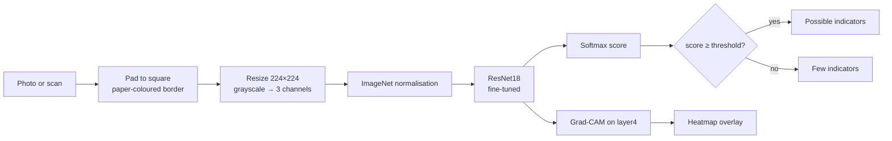

# LexiAssist

**A handwriting-based screening indicator for possible dyslexia-related patterns, built with PyTorch, explained with Grad-CAM, and served with Streamlit.**


> [!WARNING]
> **LexiAssist is an educational project, not a medical or diagnostic tool.** Dyslexia can only be diagnosed by a qualified specialist. The model was trained on a small dataset of children's handwriting labelled for *potential dysgraphia*, which is related to, but not the same as, dyslexia. Many people with dyslexia write neatly, and many people without it do not.

---

## Table of contents

- [LexiAssist](#lexiassist)
  - [Table of contents](#table-of-contents)
  - [Overview](#overview)
  - [Demo](#demo)
  - [How it works](#how-it-works)
  - [Project structure](#project-structure)
  - [Getting started](#getting-started)
    - [Prerequisites](#prerequisites)
    - [Option A: uv (recommended)](#option-a-uv-recommended)
    - [Option B: pip](#option-b-pip)
    - [Tips for best results](#tips-for-best-results)
  - [Reproducing the training (notebook)](#reproducing-the-training-notebook)
  - [Datasets](#datasets)
  - [Methodology](#methodology)
  - [Evaluation and results](#evaluation-and-results)
  - [Explainability](#explainability)
  - [Limitations](#limitations)
  - [Ethics and privacy](#ethics-and-privacy)
  - [Learning resources](#learning-resources)
  - [Roadmap](#roadmap)
  - [Acknowledgements](#acknowledgements)
  - [License](#license)

---

## Overview

LexiAssist takes a photo or scan of handwriting and returns:

1. a **score** for how closely the handwriting resembles samples rated as showing possible indicators;
2. a **screening decision** at a threshold tuned to prioritise recall (sensitivity);
3. a **Grad-CAM heatmap** showing which regions of the image influenced the score.

The project covers the full machine-learning workflow end to end:

| Stage | What's included |
|---|---|
| Data | Folder-based labelling, writer IDs, metadata export |
| Validation | Writer-aware **stratified group 5-fold cross-validation** |
| Models | A custom CNN baseline vs an **ImageNet-pretrained ResNet18** (two-stage fine-tuning) |
| Evaluation | Recall, specificity, precision, F1, ROC AUC, confusion matrix, calibration |
| Thresholding | Highest specificity subject to recall ≥ 0.90 |
| Explainability | **Grad-CAM** and **Integrated Gradients** |
| Deployment | **Streamlit** app with consent gate, privacy notice and limitations panel |
| Teaching | A "Theory" cell before every code cell, plus deep-dive notes in [`theory/`](theory/) |

## Demo

<p align="center">
  
</p>

The app on an adult's lined-paper study notes, which are well outside the training data. The Grad-CAM heatmap concentrates on the **left paper edge and shadow** rather than the writing. This is exactly the failure mode the app warns about, and it is why the result should not be trusted for inputs like this one (see [Limitations](#limitations)).

## How it works



Training, evaluation and the app all import the **same** preprocessing and model code from `app/`, so the image the model sees in production is processed exactly as during training.

## Project structure

```
LexiAssist/
├── app/                      # Everything the Streamlit app needs
│   ├── app.py                # Streamlit UI
│   ├── preprocess.py         # Shared preprocessing (pad, resize, normalise, augment)
│   ├── model.py              # SmallCNN, ResNet18 builder, checkpoint loader
│   ├── explain.py            # Grad-CAM overlay
│   ├── lexiassist.pth        # Final model checkpoint (weights + metadata)
│   └── requirements.txt      # Deployment dependencies (CPU PyTorch)
├── checkpoints/              # Per-fold CV checkpoints (SmallCNN, ResNet18)
├── theory/                   # Deep-dive notes: CNNs, training, metrics, XAI, ethics
├── Screenshots/              # Images used in this README
├── LexiAssist.ipynb          # End-to-end training notebook (Google Colab)
├── pyproject.toml            # Project dependencies (uv)
└── uv.lock                   # Locked dependency versions
```

## Getting started

### Prerequisites

- Python **3.11**
- [uv](https://docs.astral.sh/uv/) (recommended) or `pip`
- About 1 GB of disk space for CPU-only PyTorch

### Option A: uv (recommended)

```bash
git clone https://github.com/<your-username>/LexiAssist.git
cd LexiAssist
uv sync                               # creates .venv with the locked dependencies
uv run streamlit run app/app.py
```

### Option B: pip

```bash
git clone https://github.com/<your-username>/LexiAssist.git
cd LexiAssist
python -m venv .venv
source .venv/bin/activate             # Windows: .venv\Scripts\activate
pip install -r app/requirements.txt
streamlit run app/app.py
```

Then open <http://localhost:8501>, tick the consent box and upload a `.jpg`, `.jpeg` or `.png` image.

> [!NOTE]
> Both options install **CPU-only** PyTorch wheels, which are much smaller than the CUDA build and are all the app needs. The model checkpoint is about 45 MB, so if you clone a fork without it, you will need [Git LFS](https://git-lfs.com/) or to train it yourself with the notebook.

### Tips for best results

- Photograph the page flat, in even light, filling the frame with the writing.
- Crop away desks, hands and dark borders. The preprocessing pads with the colour of the image border.
- Very wide images (a single long line) lose detail when resized to 224×224; crop to a few lines.

## Reproducing the training (notebook)

[`LexiAssist.ipynb`](LexiAssist.ipynb) is designed for **Google Colab with a T4 GPU**, and also runs locally.

1. Upload the project's `app/` folder to `MyDrive/LexiAssist/app/` (the notebook imports the shared modules from there).
2. Download the datasets (below) into `MyDrive/LexiAssist/data/`.
3. Open the notebook in Colab, choose *Runtime → Change runtime type → T4 GPU*, and run all cells.
4. **Set `WRITER_REGEX`** in Phase 2 if the filenames encode a child ID. Without it, the splits are by image and the metrics will be optimistic.

The notebook writes fold checkpoints to `checkpoints/`, figures and CSV files to `outputs/`, and the final model to `app/lexiassist.pth`.

To run locally instead, start Jupyter from the project folder; the notebook detects that it is not on Colab and uses the current directory as its root.

## Datasets

The data is **not** included in this repository. Download it from the original sources and respect each dataset's licence.

| Role | Dataset | Source | Expected folder |
|---|---|---|---|
| Training and CV | *Potential Dysgraphia Handwriting Dataset of School-Age Children* (Malay sentences) | Mendeley Data, [doi:10.17632/39hr8dx76p.1](https://doi.org/10.17632/39hr8dx76p.1) | `data/dysgraphia/` |
| External test | *Multilingual AI-Based Dyslexia Detection* | Mendeley Data, [doi:10.17632/b37s8b94nv.1](https://doi.org/10.17632/b37s8b94nv.1) | `data/bilingual/` |
| Optional | Kaggle *Dyslexia Handwriting Dataset* (letter level) | Kaggle | `data/kaggle_letters/` |

Each dataset should contain one sub-folder per class. Folder names are mapped to labels by `LABEL_MAP` in the notebook (`1` = possible indicators, `0` = low indicators); edit it if your folder names differ.

## Methodology

**Preprocessing.** Images are converted to grayscale, padded to a square with the median border colour (preserving the aspect ratio of strokes), resized to 224×224, replicated to 3 channels and normalised with ImageNet statistics.

**Augmentation (training only).** Small rotations (±5°), shifts (±3%), scaling (0.95–1.05) and brightness/contrast jitter (±20%). **Horizontal flips are deliberately excluded**, because they turn `b` into `d` and letter reversals may be a genuine signal.

**Models.**

| Model | Parameters | Training |
|---|---|---|
| SmallCNN (baseline) | ~295 K | From scratch, 1 stage: 40 epochs, LR 1e-3 |
| ResNet18 | ~11.2 M | ImageNet-pretrained, 2 stages: head only (8 epochs, LR 1e-3), then full fine-tuning (25 epochs, LR 1e-4) |

Both are trained with class-weighted cross-entropy, AdamW (weight decay 1e-4), a cosine learning-rate schedule and early stopping on validation loss (patience 7).

**Validation.** `StratifiedGroupKFold` with 5 folds keeps every writer's images in a single fold and balances class ratios. In each run, one fold is the test set, the next is the validation set (early stopping only) and the remaining three are for training. The out-of-fold predictions give one unbiased score per image.

**Threshold.** Chosen on the ResNet18 out-of-fold predictions as the threshold with the highest specificity while keeping recall ≥ 0.90. The shipped model uses a threshold of **0.43**.

**Final model.** One ResNet18 trained on four folds, with the fifth used for early stopping. It is saved together with its architecture, class names, image size, normalisation statistics, threshold and data provenance.

## Evaluation and results

Running the notebook produces:

| Output | Contents |
|---|---|
| `outputs/cv_fold_metrics.csv` | Recall, specificity, precision, F1, AUC and accuracy for every fold and model |
| `outputs/evaluation.png` | ROC curves (both models), ResNet18 confusion matrix, calibration curve |
| `outputs/gradcam_examples.png` | Grad-CAM heatmaps on validation images |
| Notebook output, Phase 8 | Metrics on the external (bilingual) dataset |

Report the cross-validation metrics as **mean ± standard deviation across folds**, and read them in light of the dataset size: with a few hundred images, differences of a few percentage points are within noise.

## Explainability

- **Grad-CAM** weights the 512 feature maps of ResNet18's last block by the gradient of the class score, giving a coarse 7×7 map of supporting regions. It is shown in the app for every prediction.
- **Integrated Gradients** (Captum) attributes the score to individual pixels by integrating gradients from a baseline image to the input. It is used in the notebook as a cross-check.

Heatmaps are a **sanity check, not proof**. They can reveal shortcuts (paper edges, shadows, ruled lines, padding), as in the [demo](#demo), but cannot show that the model has learned clinically meaningful features.

## Limitations

- **Label mismatch.** Training labels are assessor ratings of *potential dysgraphia*, not clinical dyslexia diagnoses.
- **Small, narrow data.** A few hundred samples of Malay sentences written by one group of children. Results may not generalise to other ages, languages, scripts, pens, paper or cameras.
- **Writer leakage risk.** If writer IDs are not available, the cross-validation splits are by image and the metrics are optimistic.
- **Resolution.** Resizing to 224×224 can reduce pen strokes to about one pixel, losing fine detail.
- **Shortcut learning.** The model may respond to paper edges, shadows or image shape. Always check the heatmap.
- **Calibration.** Class-weighted training inflates scores for the positive class. The percentage shown is a model score, not a calibrated probability.
- **Threshold optimism.** The threshold is tuned and evaluated on the same out-of-fold predictions.

## Ethics and privacy

- **Screening, not diagnosis.** A positive result means "consider talking to a teacher or specialist", never "has dyslexia".
- **Consent.** The app requires users to confirm that they understand this and have permission to upload the handwriting.
- **Privacy.** Uploaded images are processed in memory only and never stored or sent anywhere.
- **Children's data.** The training data comes from minors. It is not redistributed here, and the model weights should be treated as derived from sensitive data.

## Learning resources

This repository doubles as a study guide. Every code cell in the notebook is preceded by a **Theory** cell explaining what the code does, why it is needed, the underlying theory (with equations), how it maps to the code, and common pitfalls.

The [`theory/`](theory/) folder goes deeper, with worked exercises and further reading:

| Notes | Topics |
|---|---|
| [01 · Images and preprocessing](theory/01_images_and_preprocessing.md) | Tensors, padding, interpolation, normalisation, augmentation |
| [02 · CNNs and ResNet](theory/02_cnns_and_resnet.md) | Convolution, receptive fields, batch norm, dropout, residual connections |
| [03 · Training and optimisation](theory/03_training_and_optimisation.md) | Cross-entropy, backpropagation, AdamW, schedules, bias–variance |
| [04 · Transfer learning](theory/04_transfer_learning.md) | Freezing, fine-tuning, learning rates |
| [05 · Validation and leakage](theory/05_validation_and_leakage.md) | Group k-fold, out-of-fold predictions, uncertainty, shortcuts |
| [06 · Metrics and thresholds](theory/06_metrics_and_thresholds.md) | ROC/AUC, prevalence, PPV/NPV, calibration |
| [07 · Explainability](theory/07_explainability.md) | Grad-CAM, Integrated Gradients, limits of saliency |
| [08 · Responsible AI](theory/08_responsible_ai.md) | Harms, bias, consent, model cards |

## Roadmap

- [ ] Extract writer IDs from filenames for a truly writer-aware split
- [ ] Crop to the text region (or tile long lines) before resizing
- [ ] Recalibrate scores (temperature scaling) on out-of-fold predictions
- [ ] Bootstrap confidence intervals by writer for all reported metrics
- [ ] Grad-CAM support for the SmallCNN architecture
- [ ] Graceful handling of corrupt or unsupported uploads in the app
- [ ] Model card documenting intended use, data and evaluation

## Acknowledgements

- The authors of the **Potential Dysgraphia Handwriting Dataset** and the **Multilingual AI-Based Dyslexia Detection** dataset (Mendeley Data).
- [PyTorch](https://pytorch.org/) and [torchvision](https://pytorch.org/vision/), [pytorch-grad-cam](https://github.com/jacobgil/pytorch-grad-cam), [Captum](https://captum.ai/), [scikit-learn](https://scikit-learn.org/) and [Streamlit](https://streamlit.io/).
- He et al. (2016), *Deep Residual Learning for Image Recognition*; Selvaraju et al. (2017), *Grad-CAM*; Sundararajan et al. (2017), *Axiomatic Attribution for Deep Networks*.

## License

MIT License. See [`LICENSE`](LICENSE) for details.

---

<p align="center">Built by Calvin Gacheru as a learning project in deep learning and computer vision.</p>
